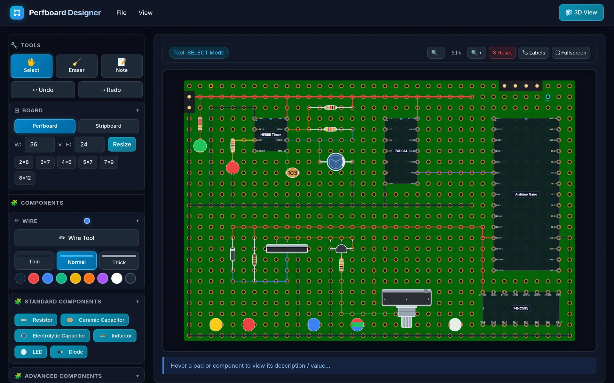
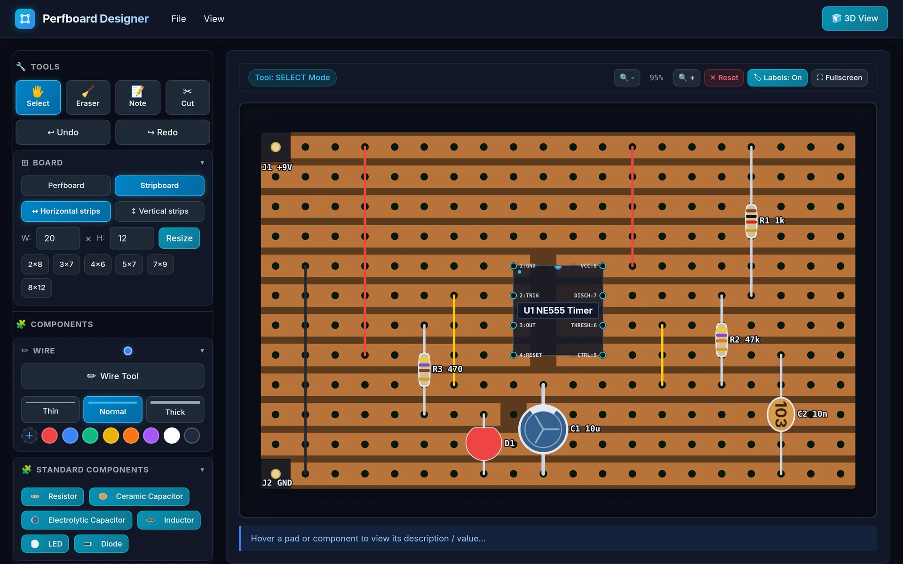
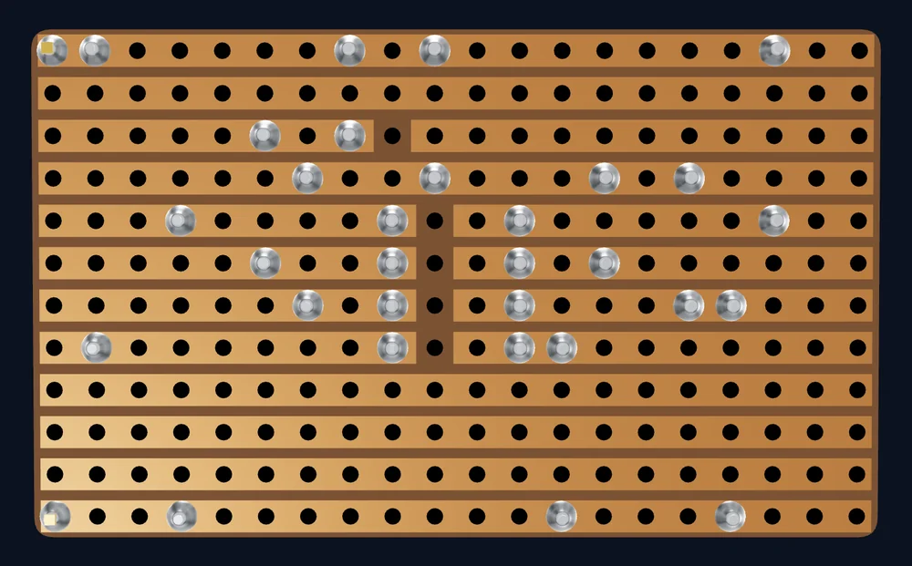
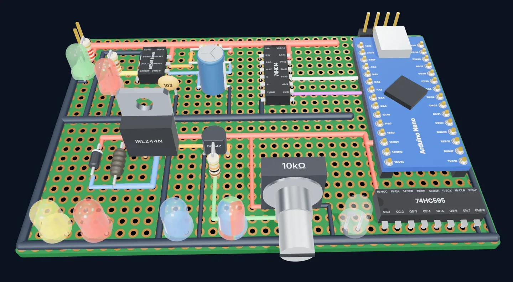
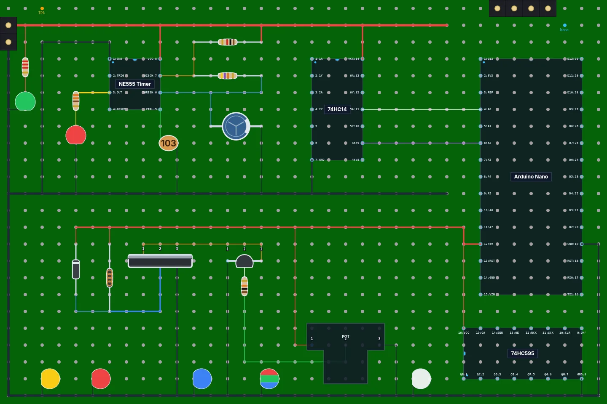
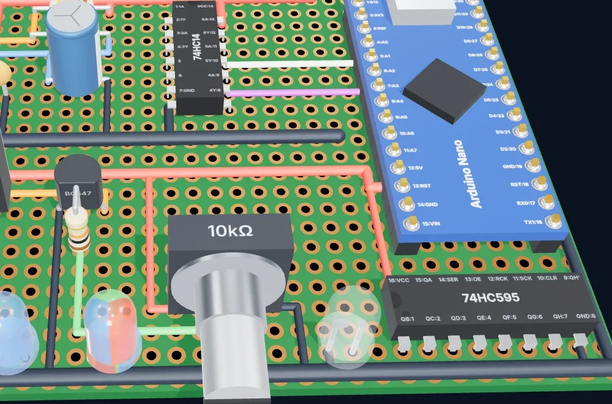

<h1 align="center">Perfboard Designer</h1>

<p align="center">
  A browser-based layout editor for perfboard and stripboard (Veroboard) circuits.<br />
  Place components and wires on the hole grid, mark strip cuts, and view the board in 3D.
</p>

<p align="center">
  <a href="https://perfboarddesigner.com/app/"></a>
</p>

<p align="center">
  
  
  
  
  
  
</p>

<p align="center">
  <a href="https://perfboarddesigner.com/app/">
    
  </a>
</p>

**[Perfboard Designer](https://perfboarddesigner.com/)** is a free, open-source **perfboard layout
tool** and **stripboard (Veroboard) planner** that runs in your web browser. Lay out resistors,
capacitors, LEDs, transistors, MOSFETs, potentiometers, header pins and ICs (NE555, ATmega328P,
Arduino Nano or your own custom chip) on a protoboard hole grid. Draw jumper wires the way you'll
solder them, cut stripboard tracks where you need a break, and see the finished board in 3D. You
catch mistakes on screen instead of at the soldering iron.

There's nothing to install, no account, and nothing is uploaded: your designs stay on your own
device.

**▶ Try it now: [perfboarddesigner.com/app](https://perfboarddesigner.com/app/)**

---

## Contents

- [Features](#features)
- [Stripboard (Veroboard) layout](#stripboard-veroboard-layout)
- [3D board preview](#3d-board-preview)
- [How to plan a perfboard layout](#how-to-plan-a-perfboard-layout)
- [Keyboard shortcuts and mouse controls](#keyboard-shortcuts-and-mouse-controls)
- [FAQ](#faq)
- [Run it locally](#run-it-locally)
- [Project file format](#project-file-format)
- [Contributing](#contributing)

---

## Features

- 🔌 **Real component library**: resistors with color bands worked out from their value
  (type `4.7k`, get yellow-violet-red), ceramic and electrolytic capacitors, inductors, diodes,
  colored LEDs, transistors, MOSFETs, potentiometers and header pins.
- 📦 **ICs and custom chips**: drop in an NE555 timer, DIP-14 and DIP-16 logic chips, an
  ATmega328P or an Arduino Nano. You can also build your own chip with labeled pins in the custom
  IC editor and edit it again later. Chips and fixed-pin parts rotate in 90° steps.
- 🔘 **Connectors, controls and power**: 2-pin and 3-pin screw terminals, female headers,
  jumper caps, push buttons, slide switches, 3296W trimmers, and 7805 / LM317 regulators.
- 🔔 **More outputs and named chips**: buzzers, DPDT relays, four-lead RGB LEDs in common-anode
  and common-cathode variants, plus LM358, LM386, PC817, ULN2803A and 74HC595 DIP presets with
  labeled pins. All appear in both the 2D editor and 3D preview.
- 🧩 **Displays, sensors and more controls**: 2-, 4- and 8-position DIP switches, common-anode
  and common-cathode seven-segment displays, quartz crystals, ceramic resonators, LDRs,
  thermistors, film capacitors, 5×20 mm fuse holders, rotary encoders and DC barrel jacks.
  Each has 2D artwork and a dedicated 3D model; check the footprint notes for parts whose
  leads must be formed to fit the grid.
- 🔋 **Everyday hobby parts**: ATtiny85, L293D, CD4017, NE556, LM393, TL072, 74HC14, 4N35 and
  6N137 DIP presets; 6×6 mm tactile, latching and toggle switches; 3 mm LEDs; 10-segment bar
  graphs and 4-digit seven-segment displays; DS18B20, DHT11/DHT22, IR receiver and electret
  microphone; 3.5 mm audio jacks, JST XH connectors, and CR2032, 2×AA and 18650 battery holders.
- ✏️ **Wires the way you solder them**: jumper wires in any color and three thicknesses (thin,
  normal, thick). Straight runs of the same color merge into one wire automatically.
- 📐 **Perfboard or stripboard, any size**: start from a common board size (2×8 cm up to
  8×12 cm) or enter your own hole count, then zoom, pan and go fullscreen while you work.
- 🏷️ **Part names and values on the board**: every part gets a reference designator (R1, C2,
  U1…). Toggle **Labels** to show them with their values as on a silkscreen (`R1 10k`).
- 📝 **Notes on any hole**: label pads like `+9V`, `GND` or `TP1` so the layout still makes sense
  months later.
- 💾 **Save, share and export**: keep as many projects as you like in the browser, saved
  automatically as you go. Share a board with a link that opens a copy of it (no account or
  upload: the board is in the link), download it as a JSON project file, or export it as a
  high-resolution PNG image.
- ↩️ **Fast to work with**: undo and redo, drag parts to move them, a right-click context menu,
  and keyboard shortcuts for the common actions.

## Stripboard (Veroboard) layout

Switch any layout between **Perfboard** and **Stripboard** with one click. On a stripboard the
copper strips run along every row (or every column), so parts on the same strip are already
connected. Use the **Cut** tool to break a strip at a hole, for example under a DIP chip so its
two rows of pins don't short. Click a cut again to mend it.

<p align="center">
  
  
</p>

- Horizontal or vertical strips, on a board of any size.
- Turn the 3D view over to check the copper strips and cuts on the solder side.
- Switch back to perfboard at any time and your parts and wires stay put.

## 3D board preview

One click on **3D View** turns the layout into a 3D model of the finished board: resistors with
their color bands, ICs with labeled pins, LEDs, capacitors, transistors, pots, headers and every
jumper wire, on a perfboard or stripboard sized to match yours.

<p align="center">
  
</p>

- Drag to orbit, right-drag to pan and scroll to zoom, or jump to an angled, top or bottom view.
- Check the solder side to see where wires and leads meet the copper.
- Save a screenshot of the render to share or keep next to your build.

Component variants use the board's 2.54 mm hole grid. Check the
[component footprint notes](docs/component-footprints.md) for package details, pin labels,
and parts whose leads must be formed to fit the grid. The models are layout previews, not
manufacturing drawings. To explore the expanded catalog in 2D and 3D, import one of the component
galleries: [connectors](examples/new-components-connectors.json),
[batteries](examples/new-components-batteries.json), [switches](examples/new-components-switches.json),
[displays and LEDs](examples/new-components-displays-leds.json),
[passives and sensors](examples/new-components-passives-sensors.json) and
[DIP chips](examples/new-components-dip-chips.json). They show parts, not working circuits.

<p align="center">
  
  
</p>

## How to plan a perfboard layout

1. **Pick your board**: open the [designer](https://perfboarddesigner.com/app/), choose
   **Perfboard** or **Stripboard**, then a preset or the number of holes across and down to match
   the board on your bench.
2. **Place parts and wires**: pick a component, then click the holes for its leads. Rotate chips
   with `R` and draw wires between pins with the **Wire Tool** (`W`).
3. **Check it in 3D**: open **3D View** to see how everything fits, and flip the board to check
   the solder side.
4. **Save it and build it**: use **File → Save Project to File** to keep the design, and
   **File → Download Image** to print a PNG for your workbench.

## Keyboard shortcuts and mouse controls

| Action | Shortcut / gesture |
| :--- | :--- |
| Toggle the wire tool | `W` |
| Rotate the selected chip or part | `R` |
| Add a note to the selected hole | `D` |
| Remove a hole's note | `Shift` + `D` |
| Change the selected hole's color | `C` |
| Delete the selected part or wire | `Delete` |
| Undo / redo | `Ctrl` + `Z` / `Ctrl` + `Y` |
| Deselect, or step back out of a tool | `Esc` |
| Fullscreen | `F` |
| Download the board as an image | `P` |
| Zoom (20% to 300%, around the cursor) | Mouse wheel, or the 🔍 buttons |
| Pan | Left-drag empty space, `Space` + drag, or middle-mouse drag |
| Rotate, recolor, add a note, set a value or delete | Right-click |

## FAQ

### Is Perfboard Designer free?

Yes. It's completely free and open source, with no account, ads or limits.

### Do I need to install anything?

No. It runs in any modern web browser, and works best on a desktop or laptop with a mouse.

### Where are my designs saved?

On your own device. Your projects are saved in this browser automatically as you edit: open,
rename, duplicate or delete them from **File → Open Project**. **Save Project to File** downloads a
project file you can import again or share, and **Share** makes a link with the board inside
the link itself. Nothing is uploaded to a server.

### Does it work for stripboard (Veroboard)?

Yes. Switch the board to Stripboard and copper strips run along every row or column. Use the Cut
tool to cut a strip at any hole; the cuts are saved with your project and shown on the copper side
of the 3D view.

### Can I add a chip that isn't in the list?

Yes. The custom IC editor lets you set the size and label every pin, and you can edit a custom
chip again after creating it.

### Does it simulate or check my circuit?
Not yet. Perfboard Designer is a layout planner: it helps you work out where parts and wires go on the board. It doesn’t simulate circuits, but basic checks of your layout are planned and in progress.

## Run it locally

You need [Node.js](https://nodejs.org/) 16 or newer.

```bash
git clone https://github.com/MaurerKrisztian/perfboard-designer.git
cd perfboard-designer
npm install
npm run start
```

Then open <http://localhost:3000/app/> for the editor (<http://localhost:3000/> is the landing
page).

| Command | What it does |
| :--- | :--- |
| `npm run start` | Dev server with hot reload |
| `npm run build` | Type-check and build the site into `dist/` |
| `npm run serve` | Preview the production build |
| `npm run lint` | Lint `src/` with ESLint |

It's built with vanilla TypeScript and the HTML5 Canvas API, with no UI framework. Vite bundles
it, and three.js powers the 3D view (it's lazy-loaded, so the editor itself stays small).

## Project file format

Projects are saved as plain, readable JSON (format version 3): the board type and size, strip
cuts, wires, and every part with its reference designator, all as `[column, row]` grid positions
rather than pixels. Files from older versions still open. The format is documented field by field
in [`src/project-file/project-file.ts`](src/project-file/project-file.ts), and the
[`examples/`](examples) folder has sample projects to open with **File → Import Project from File**.
Share links carry the same file, and can be made by other programs (an AI agent designing a board,
say): see [docs/share-links.md](docs/share-links.md).

## Contributing

Bug reports, ideas and pull requests are welcome:

- 🐞 [Report a bug or suggest a feature](https://github.com/MaurerKrisztian/perfboard-designer/issues)
- 🔧 Fork the repo and open a pull request
- 👥 See the [people who've already helped](https://perfboarddesigner.com/contributors/)

If Perfboard Designer saved you a desoldering session, a ⭐ on GitHub helps other makers find it.

## License

Distributed under the ISC License.
